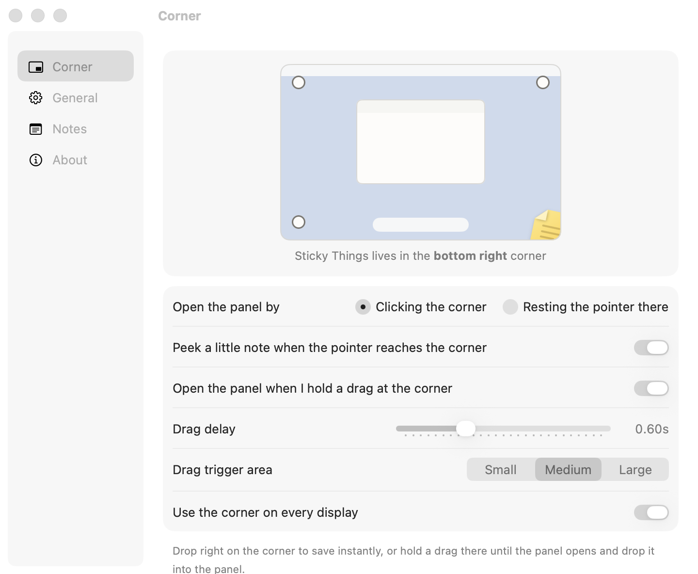

<p align="center"></p>

<h1 align="center">Sticky Things</h1>

<p align="center"><b>Quick notes that are actually quick.</b><br>
A native macOS menu-bar stash for everything you copy, drag, or throw at the corner.</p>

<p align="center">
  
  
  
</p>

<p align="center"></p>

Sticky Things replaces macOS's Quick Note hot corner. Click a screen corner and a panel opens from it with the cursor already in the composer. Paste, type, or drag anything in, then copy it back with one click. Hold a drag at the corner for a moment and the panel opens so you can drop it straight into the stack.

It is built for the kind of thing you need for ten seconds: a Wi-Fi password, a screenshot, an address, a PDF you have to send on, a thought you do not want to lose.

## Screenshots

| Panel, light | Panel, dark |
|---|---|
|  |  |

| Captions on media and documents | Settings, corner behavior |
|---|---|
|  |  |

| Empty | Corner peek |
|---|---|
|  |  |

<sub>Renders are offscreen snapshots. The installed app draws its panel on real system glass.</sub>

## What it does

- **Throw anything in.** Press ⌘V to save whatever you copied, or drag in text, rich text, links, screenshots, images, PDFs, files, folders, Photos, Mail attachments, or app data like Figma layers. Everything is captured losslessly, so it comes back out exactly as it went in.
- **Add your own words to anything.** Images, PDFs, files and folders can carry a caption. Click the speech-bubble button on the card, press ⌘⇧E, or use the right-click menu. Captions are searchable and undoable.
- **Edit in place.** Click a note to edit it in the card, formatting included. Return or Save keeps it, Esc cancels, and clicking anywhere else saves too. ⌘Z brings back the old version.
- **Get it back in one click.** Click a link, image or file to copy it, or use any card's Copy button or ⌘C. Drag a card into any app, or press ↑ then ↩ to copy and close.
- **Throw it at the corner.** Drop something on the corner to save it without opening anything. Hold a drag there, watch the note shake, and the panel opens after a short delay so you can drop it into the stack.
- **Find it again.** Search everything, filter by Notes, Links, Images or Files, pin favorites to ⌘1 to ⌘9, and preview anything with Space.
- **Stay out of the way.** It lives in the menu bar, opens like Spotlight without switching apps, and gives focus back when it closes.

## Install

You need macOS 14 or newer and Xcode 16 or newer with the Swift 6 toolchain.

```bash
git clone https://github.com/LevelPanic/sticky-things.git
cd sticky-things
make install
```

`make install` builds a release app, copies it to `/Applications/Sticky Things.app`, and launches it. To build and run from the project folder instead:

```bash
make run
```

On first launch, Sticky Things walks you through:

1. Picking a corner.
2. Freeing that corner from Apple's Hot Corners, either with one click or from System Settings while the app updates live.
3. Trying it once.

macOS does not let apps add themselves to the Hot Corners menu, so Sticky Things watches the corner itself. You can run the setup again from the menu bar icon under **Set Up Corner...**.

> The current build is ad-hoc signed, not notarized. It is a project in active development, not a Mac App Store download.

## Keys

| Shortcut | Action |
|---|---|
| Click the corner or **⌃⌥N** | Open or close the panel |
| Hold a drag at the corner | Shake, then open the panel so you can drop into it |
| **⌘V** | Save whatever you copied (**⌥⌘V** puts the text in the composer instead) |
| **↩** / **⇧↩** | Save the note / start a new line |
| **↑ ↓** | Browse items; **↩** copies the selected item and closes |
| **Space** | Quick Look |
| **⌘E** / **⌘O** / **⌘P** / **⌘⌫** | Edit / open / pin / delete (**⌘Z** to undo) |
| **⌘⇧E** | Add or edit a caption on a media item or document |
| While editing: **↩** / **⇧↩** / **Esc** | Save / new line / cancel |
| **⌘1** to **⌘9** | Copy a pinned item and close |
| **⌘F** / **Esc** | Search / step back, then close |

Every action is also in the right-click menu and available to VoiceOver.

## How it is built

Three Swift modules, each with its own tests:

- **StickyCore:** lossless pasteboard capture, SQLite and content-addressed blob storage, file copies, clipboard and drag output.
- **StickyDesign:** an Impeccable-based design system with tokens, contrast tests and a design lint.
- **StickyThings:** the app, including the corner windows, panel, onboarding, Settings and menu bar item.

The short version of the data flow:

```text
⌘V / drop / corner drop
        |
        v
PasteboardSnapshotter  ->  CapturedClip
        |
        v
Classifier  ->  kind, text, title, link, size
        |
        v
CaptureService  ->  Item  ->  SQLite + blobs + file library
        |
        v
PasteboardWriter  ->  the original data, exactly as it came in
```

Your items live in `~/Library/Application Support/Sticky Things/`. Nothing leaves your Mac except the one-time fetch of a saved link's title and icon. There is no analytics and no account.

### Development commands

```bash
make test        # 46 unit tests: core, design system, app logic
make selftest    # drives the real panel through accessibility (57 checks)
make layout      # checks every panel state against the design grid, with captures
make snapshots   # renders every screen to build/snapshots
make install     # release build, copy to /Applications and launch
```

Each command uses a throwaway library and private pasteboards, so your real items and clipboard are untouched.

### Project docs

| Doc | What is in it |
|---|---|
| [docs/ARCHITECTURE.md](docs/ARCHITECTURE.md) | Data flow, storage layout, and the decisions behind them |
| [docs/DESIGN.md](docs/DESIGN.md) | Design tokens, components, writing rules, and what the tests enforce |
| [docs/PLATFORM.md](docs/PLATFORM.md) | How macOS handles pasteboards, file promises, drags, focus, hover and privacy |
| [docs/TESTING.md](docs/TESTING.md) | Unit tests, design lint, the UI self-test, snapshots, and the manual pass |

## Status

Sticky Things is an active work in progress. The core is built and tested, and I am using it every day while tightening the rough edges.

Working now:

- [x] Lossless capture of text, rich text, links, images, PDFs, files and folders
- [x] SQLite storage with a content-addressed blob store
- [x] Hot corner panel, keyboard shortcut, menu bar item and native Settings
- [x] Edit notes and captions in place, with undo
- [x] Drag to save, drag to open, and drag back out
- [x] Design system, contrast tests, design lint, self-test and layout audit
- [ ] Notarized download and a proper installer
- [ ] More real-world drag coverage (Preview, Photos, Mail, Figma)
- [ ] A cleaner first-run guide for the permission-free Hot Corners setup

Known limits:

- Multi-file items drag out as the first file; copying gives all of them.
- Concealed password-manager copies are blurred in the UI but not encrypted at rest.
- Offscreen snapshots use a flat surface, so the real panel's Liquid Glass look only appears in the installed app.

## Credits

Built by **[Muhtasham Nawaz](https://github.com/LevelPanic)**.

Inspired by [StickyEdges](https://github.com/utsavg05/StickyEdges), and by every note that got lost in a browser tab.

## License

MIT. See [LICENSE](LICENSE).
