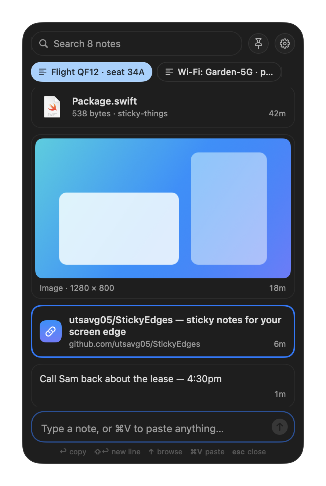
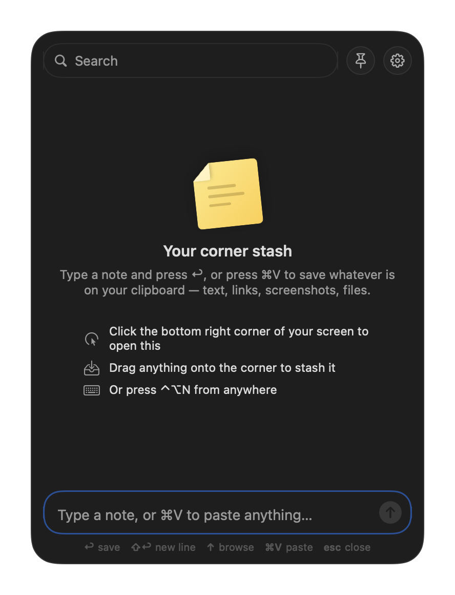
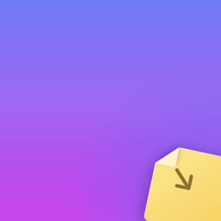

<p align="center"></p>

<h1 align="center">Sticky Things</h1>

<p align="center"><b>Quick notes that are actually quick.</b><br>
Click the corner of your screen, paste anything, done.</p>

---

Sticky Things replaces macOS's Quick Note hot corner with something you'll actually use. Click the
bottom-right corner (or any corner you pick) and a little stack slides out with the cursor already
in a text box:

- **Paste anything with ⌘V** — text, links, screenshots, images, files copied in Finder. It's saved
  the moment you paste, no extra step.
- **Type a note and press ↩.** Shift-↩ for a new line.
- **Browse with ↑ / ↓** like shell history: the newest thing sits right above the text box and older
  things stack up behind it. ↩ copies the selected note and closes, so you can paste it where you are.
- **Throw things at the corner.** Drag a file, image or text onto the corner and it's stashed
  without opening anything.

It's a native Swift/SwiftUI app with Liquid Glass on macOS 26, no Dock icon, and it runs offline
except for fetching link titles.

| The stack | Empty state | Corner peek | Drop on the corner |
|---|---|---|---|
|  |  |  |  |

> Screenshots are offscreen renders with a flat background. The real panel uses Liquid Glass.

## Install

You need macOS 14 or newer and Xcode 16+ (or its command line tools).

```bash
make install     # builds, copies "Sticky Things.app" to /Applications and launches it
```

Or `make app` to build `build/Sticky Things.app` without installing. `make run` builds and launches it from `build/`.

### Turn off Apple's Quick Note corner

macOS ships with **Quick Note** on the bottom-right hot corner, so both would pop up. The panel shows a
banner with a **Turn Off Quick Note Corner** button. It sets that hot corner to “–” and restarts the
Dock. You can also do it yourself in **System Settings › Desktop & Dock › Hot Corners…**, or move
Sticky Things to a different corner.

## Using it

| | |
|---|---|
| **Click the corner** | Open / close the panel. A small sticky note peeks out when your pointer arrives. |
| **⌃⌥N** (anywhere) | Open / close the panel (change it in Settings). |
| **Menu bar icon** | Click to open; right-click for Settings and Quit. Can be hidden. |
| **Drag onto the corner or panel** | Save files, images, text or links. |
| **Drag a note out** | Drop it into any app (text, link, image or the original file). |

### In the panel

| Key | Does |
|---|---|
| `↩` | Save what you typed · copy the selected note and close |
| `⌘V` | Save whatever is on the clipboard instantly (when the box is empty) |
| `⌥⌘V` | Paste into the box as text, to edit before saving |
| `⇧↩` | New line |
| `↑` `↓` | Browse notes |
| `⌘C` | Copy the selected note |
| `⌘E` / double-click | Edit a text note (or open a link/file/image) |
| `⌘O` | Open the selected link, file or image |
| `⌘P` | Pin / unpin (pinned notes live in the strip at the top) |
| `⌘1`…`⌘9` | Copy pinned note 1–9 and close |
| `⌘⌫` | Delete (`⌘Z` or the toast's Undo brings it back) |
| `⌘F` / `Tab` | Search |
| `esc` | Clear selection / search, then close |

Click a card to copy it. Right-click a card to change its color, pin it, open it or delete it. The 📌 in the
header keeps the panel open while you work in other apps.

### Settings


- **Corner:** pick any corner on a mini screen, open by click or hover (with a delay), turn the peek
  animation on or off, and choose whether to use the corner on every display. On multiple displays only
  “hard” corners are used, ones the pointer can't slide past onto another screen.
- **General:** open at login, menu bar icon, global shortcut, link previews.
- **Notes:** how long to keep unpinned notes (forever by default), Show in Finder, Delete all.

## Where your notes live

Everything stays on your Mac in `~/Library/Application Support/Sticky Things/`:
`notes.json` holds the notes and `media/` holds pasted images and link icons. Files you paste are saved
as references (with a bookmark, so they're found again if moved), not copied.

## Automation

```bash
open "stickythings://open"                     # toggle the panel
open "stickythings://add?text=Buy%20milk"      # add a note
open "stickythings://settings"
```

## Development

```bash
swift build                   # debug build
make test                     # unit tests (clipboard parsing, storage, geometry)
.build/debug/StickyThings --snapshot /tmp/snaps   # render the UI to PNGs with sample notes
make icon                     # redraw Resources/AppIcon.icns
```

```text
Sources/StickyThings/
  App/        entry point, app wiring, snapshot renderer
  Corner/     hot-corner windows (peek, click/hover, drop target) + multi-display management
  Panel/      the slide-out panel: model, SwiftUI views, text input, focus handling
  Model/      Note, clipboard parsing, storage, link previews, copy/open/drag helpers
  Settings/   preferences, settings window, corner picker, shortcut recorder
  System/     global hotkey, menu bar icon, login item, macOS hot-corner detection
```

How it works: each corner is a tiny transparent always-on-top window. It grows when the pointer
reaches it so the note can peek out, and it registers as a drag destination. The panel is a borderless
`NSPanel` that takes the keyboard without activating the app, so the app you were in stays in front.
When macOS won't allow that (e.g. when opened from a URL), it activates and hands focus back when it
closes. None of this needs Accessibility or Screen Recording permission.

## Notes & limits

- The app is ad-hoc signed for your own Mac. To share it with others it would need a Developer ID
  signature and notarization.
- Rich text is saved as plain text. Images are saved as PNG.
- Inspired by [StickyEdges](https://github.com/utsavg05/StickyEdges), which tucks sticky notes into the
  screen edge. Sticky Things instead puts one quick-capture stack in a corner.
