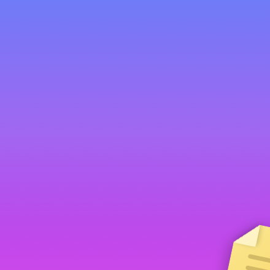

<p align="center"></p>

<h1 align="center">Sticky Things</h1>

<p align="center"><b>Quick notes that are actually quick.</b><br>
Click the corner of your screen and throw anything in.</p>

---

Sticky Things replaces macOS's Quick Note hot corner. Click the bottom-right corner (or any corner you pick) and a panel opens from it with the cursor already in the composer.

- **Throw anything in.** Press ⌘V to save whatever you copied, or drag in anything:
  - text and rich text from any app
  - links (with page title and icon)
  - screenshots, images and PDFs (including pages dragged out of Preview)
  - files and folders from Finder
  - photos, Mail attachments, and private app data like Figma layers

  Everything is kept losslessly, so it comes back out exactly as it went in.
- **Edit in place.** Click a note to edit it right there in the card, formatting included. Return or Save keeps the change, Esc cancels, and clicking anywhere else keeps it too. Saved edits can be undone. Rather have a click copy notes? Settings ▸ Notes ▸ Clicking a note.
- **Get it back in one click.** Click a link, image or file to copy it, or use any card's Copy button (or ⌘C). Drag a card into any app, or press ↑ then ↩ to copy and close.
- **Throw at the corner.** Drop something on the corner itself to save it without opening anything.
- **Find it again.** Search, filter (Notes · Links · Images · Files), pin favorites (⌘1–⌘9), and preview anything with Space (Quick Look).

| The stack | Dark | Empty | Corner peek | Drop on the corner |
|---|---|---|---|---|
|  |  |  |  |  |

<sub>Screenshots are offscreen renders. The real panel sits on Liquid Glass.</sub>

## Install

You need macOS 14 or newer (it's designed for macOS 26) and Xcode 16 or newer.

```bash
make install     # build, copy to /Applications, launch
```

The first launch walks you through setup:

1. Pick a corner.
2. Free it from Apple's Hot Corners, either with one click or by opening System Settings at Hot Corners while the screen updates live.
3. Try it once.

macOS doesn't let apps add themselves to the Hot Corners menu, so Sticky Things watches the corner itself. Run the setup again from the menu bar icon ▸ **Set Up Corner…**.

## Keys

| | |
|---|---|
| Click the corner or press **⌃⌥N** | Open or close |
| **⌘V** | Save whatever you copied (⌥⌘V puts it in the composer instead) |
| **↩** / **⇧↩** | Save the note / new line |
| **↑ ↓** | Browse; **↩** copies the selected item and closes |
| **Space** | Quick Look |
| **⌘E**, **⌘O**, **⌘P**, **⌘⌫** | Edit, open, pin, delete (**⌘Z** to undo) |
| While editing: **↩** / **⇧↩** / **Esc** | Save / new line / cancel |
| **⌘1–⌘9** | Copy a pinned item and close |
| **⌘F** / **Esc** | Search / step back, then close |

Every action is also in the right-click menu and available to VoiceOver.

## How it's built

Three Swift modules, each with its own tests:

- **StickyCore:** lossless capture, SQLite and content-addressed storage, and clipboard output.
- **StickyDesign:** an Impeccable-based design system, with contrast and lint tests.
- **StickyThings:** the app.

| Doc | What's in it |
|---|---|
| [docs/ARCHITECTURE.md](docs/ARCHITECTURE.md) | Data flow, storage layout, key decisions |
| [docs/DESIGN.md](docs/DESIGN.md) | Tokens, components, writing rules, what's enforced automatically |
| [docs/PLATFORM.md](docs/PLATFORM.md) | How macOS handles pasteboards, file promises, Preview and Finder drags, privacy, focus and hover, and what we do about each |
| [docs/TESTING.md](docs/TESTING.md) | Unit tests, design lint, the UI self-test, snapshots, and the manual drag matrix |

```bash
make test        # 39 unit tests (core, design system, app logic)
make selftest    # drives the real panel through accessibility (throwaway library)
make layout      # checks every panel state against the design grid, with captures
make snapshots   # renders every screen to build/snapshots
```

Your items live in `~/Library/Application Support/Sticky Things/`, and nothing leaves your Mac except the one-time fetch of a saved link's title and icon. Automation hooks: `stickythings://open`, `…://add?text=…`, `…://settings`, `…://setup`.

Inspired by [StickyEdges](https://github.com/utsavg05/StickyEdges).
