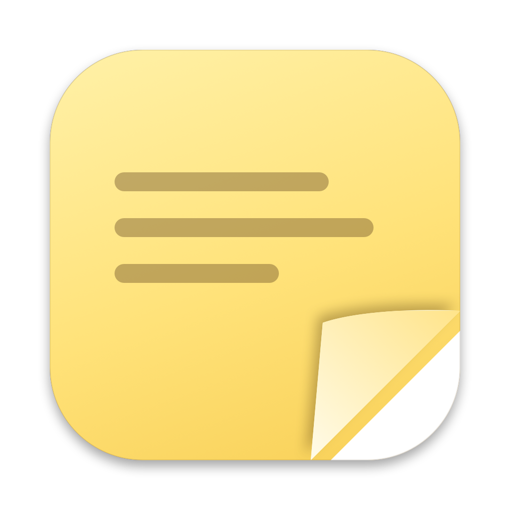
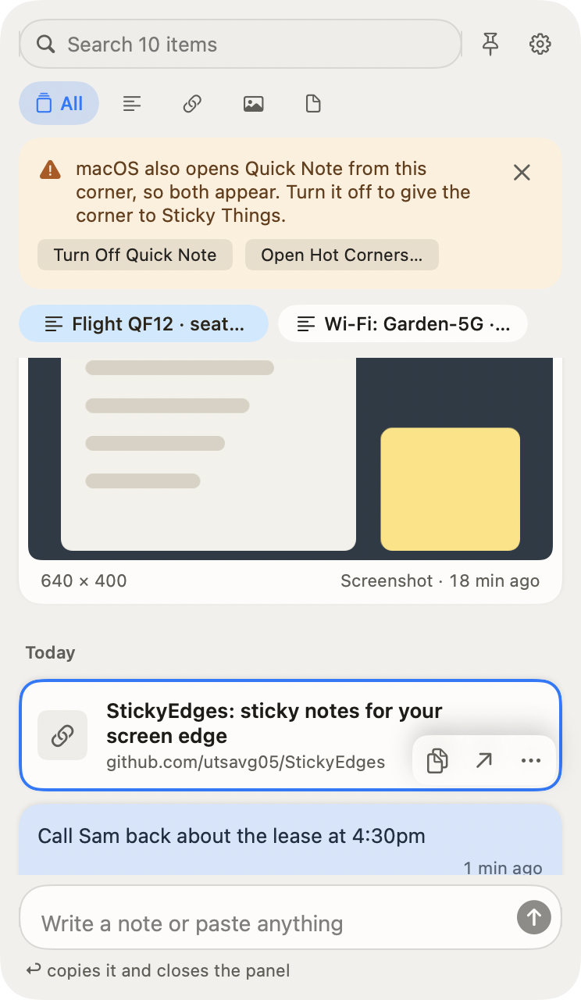
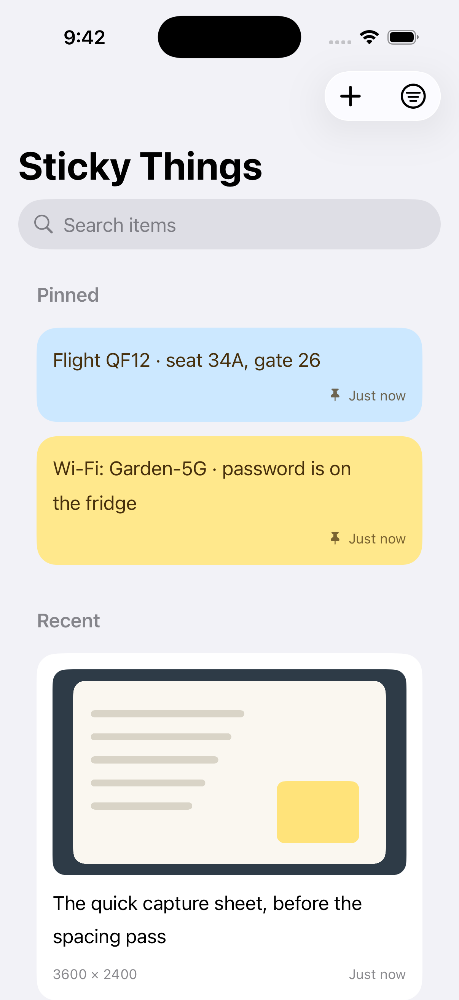
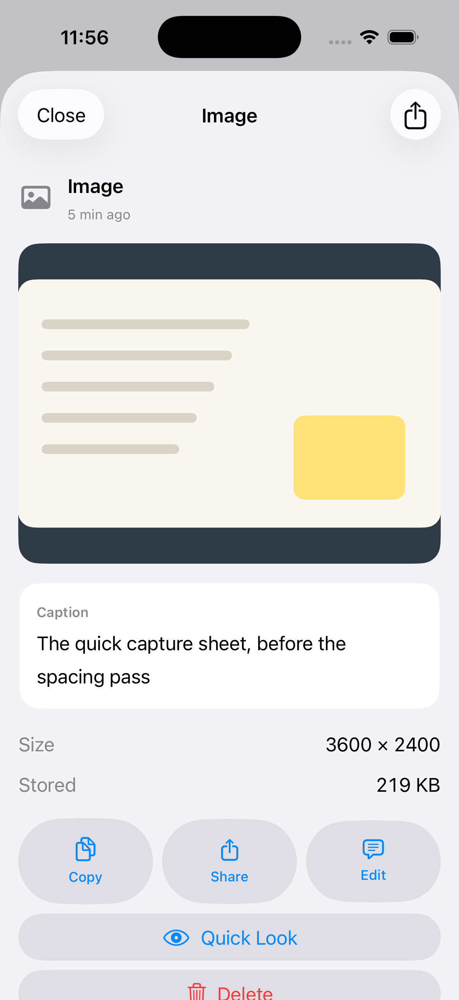
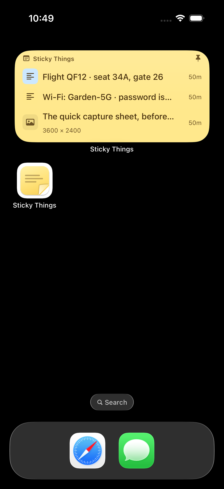
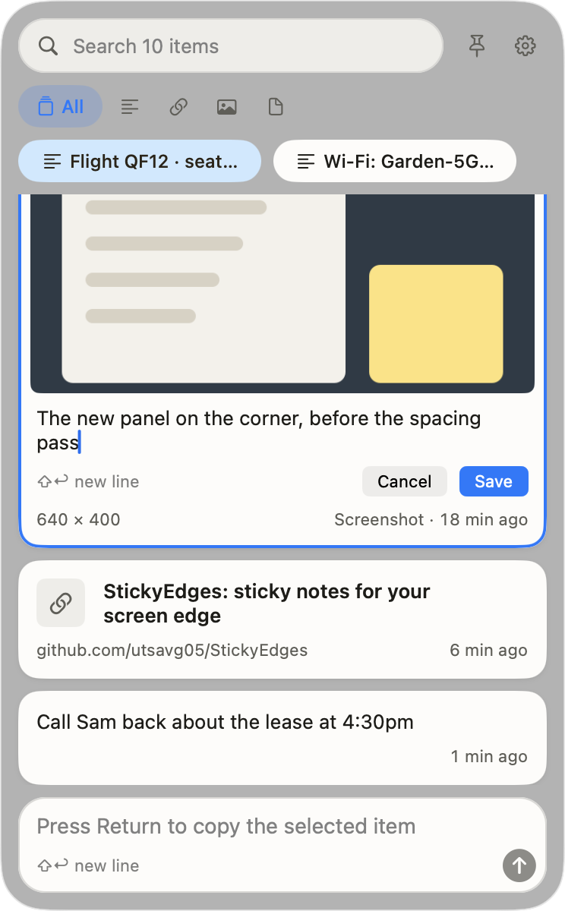
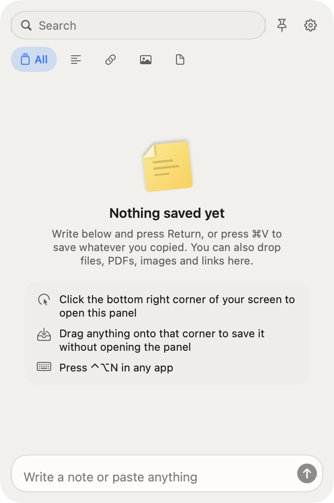

<p align="center"></p>

<h1 align="center">Sticky Things</h1>

<p align="center"><b>Quick notes that are actually quick.</b><br>
A native quick-capture app for macOS and iOS. Throw anything in, get it back in one click.</p>

<p align="center">
  
  
  
  
</p>

<p align="center"></p>

Sticky Things replaces macOS's Quick Note hot corner. Click a screen corner and a panel opens with the cursor already in the composer. Paste, type, or drag anything in, then copy it back with one click. Hold a drag at the corner for a moment and the panel opens so you can drop it straight into the stack.

The iPhone app is designed around the places iOS already gives you for a five-second capture: the Action Button, Control Center, the Lock Screen, the share sheet, Siri, and Spotlight. No dock icon hunting, no blank app to navigate.

## Screenshots

| macOS, light | macOS, dark | iPhone, library |
|---|---|---|
|  |  |  |

| iPhone, quick capture | iPhone, item detail | iPhone, widget |
|---|---|---|
|  |  |  |

| macOS, captions | macOS, corner behavior | macOS, empty |
|---|---|---|
|  |  |  |

<sub>Mac renders are offscreen snapshots. The installed Mac app draws its panel on real system glass. iPhone screenshots are from the simulator.</sub>

## Platforms

| Platform | Status | Built with |
|---|---|---|
| macOS | Working build, used daily | Swift, SwiftUI, AppKit |
| iOS | New app, Action Button and share sheet integrated | SwiftUI, App Intents, WidgetKit |
| Windows | Planned | Native shell + shared storage format |
| Android | Planned | Native shell + shared storage format |

The same `Item` model, SQLite schema, blob store and file library back both Apple apps. The Mac path and iOS App Group path are documented in [docs/ARCHITECTURE.md](docs/ARCHITECTURE.md) and [apps/ios/README.md](apps/ios/README.md).

## What it does

- **Throw anything in.** Press ⌘V on the Mac, tap Paste on iPhone, or drag in text, rich text, links, screenshots, images, PDFs, files, folders, Photos, Mail attachments, or app data like Figma layers. Everything is captured losslessly.
- **Quick capture from anywhere on iPhone.** Add the **New Sticky Thing** control to the Action Button, Control Center, or Lock Screen. A single press opens the composer with the keyboard up.
- **Share from any app on iPhone.** The Share extension saves links, text, photos, PDFs and files straight into the same library.
- **Add your own words to anything.** Images, PDFs, files and folders can carry a searchable, undoable caption. On Mac: the speech-bubble button, ⌘⇧E, or the right-click menu. On iPhone: the item's context menu or detail screen.
- **Edit in place.** Click a note on Mac or open its detail on iPhone. Return or Save keeps the change, Esc cancels, and clicking away saves too.
- **Get it back in one click.** Click a link, image or file to copy it. On iPhone the system share sheet and Quick Look are one tap away.
- **Throw it at the corner.** On Mac, drop something on the corner to save it without opening anything. Hold a drag there, watch the note shake, and the panel opens after a short delay.
- **Find it again.** Search, filters, pinned items, and Spotlight indexing on iPhone.
- **Native system surfaces.** Status item, hot corner and global shortcut on Mac; Action Button, Control Center, Lock Screen, Home Screen widget, Home Screen quick action, share sheet, Siri, Shortcuts, Spotlight, system Paste, Quick Look and iPad drag and drop on iPhone.
- **Stay out of the way.** Local-first, no account, no analytics.

## Install

### macOS

You need macOS 14 or newer and Xcode 16 or newer with the Swift 6 toolchain.

```bash
git clone https://github.com/LevelPanic/sticky-things.git
cd sticky-things
make install
```

`make install` builds a release app, copies it to `/Applications/Sticky Things.app`, and launches it. To build and run from the project folder instead:

```bash
make run
```

On first launch, pick a corner, free it from Apple's Hot Corners, and try it once. macOS does not let apps add themselves to the Hot Corners menu, so Sticky Things watches the corner itself. Run the setup again from the menu bar icon under **Set Up Corner...**.

### iOS

You need Xcode 26 or newer and iOS 18 or newer.

```bash
brew install xcodegen
make ios-project
make ios-open
```

Select your Development Team, register the App Group `group.app.stickythings`, and run on a device. The Action Button and Control Center picker do not exist in the simulator; the full setup is in [apps/ios/README.md](apps/ios/README.md).

> Both apps are ad-hoc signed local builds for now, not notarized downloads from the App Store.

## Keys on macOS

| Shortcut | Action |
|---|---|
| Click the corner or **⌃⌥N** | Open or close the panel |
| Hold a drag at the corner | Shake, then open the panel so you can drop into it |
| **⌘V** | Save whatever you copied (**⌥⌘V** puts the text in the composer instead) |
| **↩** / **⇧↩** | Save the note / start a new line |
| **↑ ↓** | Browse items; **↩** copies the selected item and closes |
| **Space** | Quick Look |
| **⌘E** / **⌘O** / **⌘P** / **⌘⌫** | Edit / open / pin / delete (**⌘Z** to undo) |
| **⌘⇧E** | Add or edit a caption on a media item or document |
| While editing: **↩** / **⇧↩** / **Esc** | Save / new line / cancel |
| **⌘1** to **⌘9** | Copy a pinned item and close |
| **⌘F** / **Esc** | Search / step back, then close |

## How it is built

This is a monorepo. The Apple apps share a core, while each app uses the native UI and system features of its platform.

```text
apps/
  macos/       the Mac app: corner windows, panel, onboarding, Settings
  ios/         the iPhone app, Share extension and Control widget
packages/
  StickyCore/  cross-platform item model, SQLite, blob store, capture and file library
  StickyDesign/ macOS design tokens and components
docs/          architecture, design, platform and testing notes
```

The shared core means a caption, a file copy or a tag has the same meaning on both platforms. The apps deliberately do not share a UI: the Mac uses a floating glass panel and hot corners, while iOS uses the Action Button, share sheet, sheets and system controls.

### Development commands

```bash
make test        # all 46 unit tests
make test-core   # shared capture and storage tests only
make test-design # macOS design system, contrast and lint tests only
make test-app    # macOS app logic tests only (PanelModel, corners, settings)
make test-macos  # all macOS-specific tests (design system + app logic)
make test-filter FILTER=PanelModel
make selftest    # drives the real Mac panel through accessibility (57 checks)
make layout      # checks every Mac panel state against the design grid
make snapshots   # renders every Mac screen to build/snapshots
make ios-project # regenerate the iOS Xcode project
make ios-build   # build the iOS app, Share extension, Home Screen widget and Control widget
make install     # release build the Mac app, copy to /Applications and launch
```

### Project docs

| Doc | What is in it |
|---|---|
| [docs/ARCHITECTURE.md](docs/ARCHITECTURE.md) | Shared data flow, storage layout, and platform layers |
| [docs/DESIGN.md](docs/DESIGN.md) | Mac design tokens, components, writing rules, and what the tests enforce |
| [docs/PLATFORM.md](docs/PLATFORM.md) | How macOS and iOS handle pasteboards, drags, focus, privacy and extensions |
| [docs/TESTING.md](docs/TESTING.md) | Unit tests, design lint, the Mac self-test, snapshots, and the manual pass |
| [apps/ios/README.md](apps/ios/README.md) | iOS build, Action Button, Share extension, Spotlight, and system integrations |

## Status

Sticky Things is an active work in progress. The Mac app is in daily use. The iOS app is new and built around the native system entry points.

Working now:

- [x] Lossless capture of text, rich text, links, images, PDFs, files and folders
- [x] Shared SQLite and content-addressed blob store across macOS and iOS
- [x] Mac hot corner, keyboard shortcut, menu bar item and native Settings
- [x] iPhone Action Button, Control Center, Lock Screen, Home Screen widget, Home Screen quick action, share sheet, Siri, Shortcuts and Spotlight
- [x] Edit notes and captions in place, with undo
- [x] Drag to save, drag to open, drag back out on Mac; drag and drop into the iOS list on iPad
- [x] Design system, contrast tests, design lint, self-test and layout audit on Mac
- [ ] iCloud or CloudKit sync between Mac and iPhone
- [ ] Notarized macOS download and App Store build
- [ ] Windows and Android shells on the shared storage format

Known limits:

- The iOS Share extension needs the App Group capability to be provisioned for device builds.
- Multi-file items drag out as the first file; copying gives all of them.
- Concealed password-manager copies are blurred in the UI but not encrypted at rest.
- Offscreen Mac snapshots use a flat surface, so the real panel's Liquid Glass look only appears in the installed app.

## Privacy

Your items stay in the library on your device. There is no account, analytics, or background clipboard reading. The Mac app fetches a saved link's title and icon once when you save it. The iOS app indexes items in the on-device Spotlight index and never indexes concealed copies.

## Credits

Built by **[Muhtasham Nawaz](https://github.com/LevelPanic)**.

Inspired by [StickyEdges](https://github.com/utsavg05/StickyEdges), and by every note that got lost in a browser tab.

## License

MIT. See [LICENSE](LICENSE).
