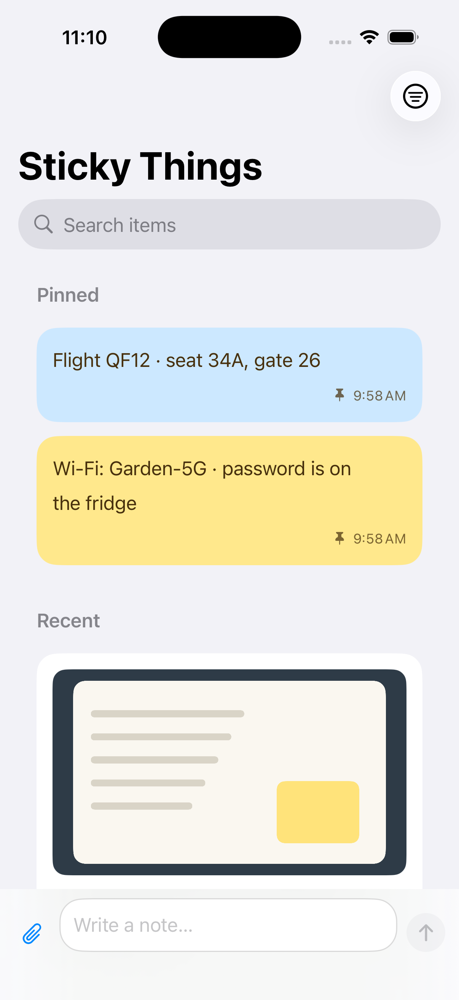
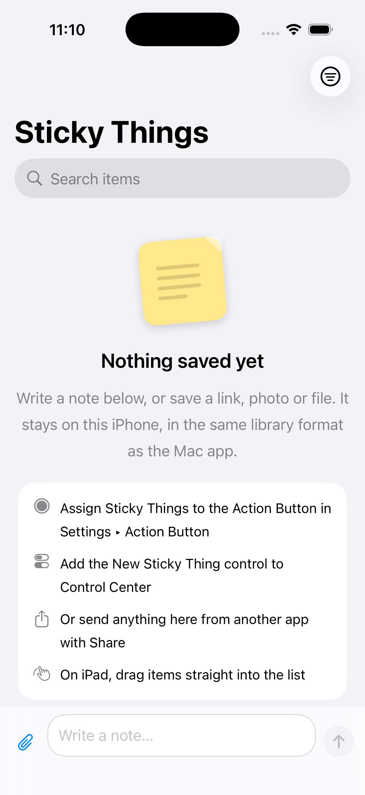
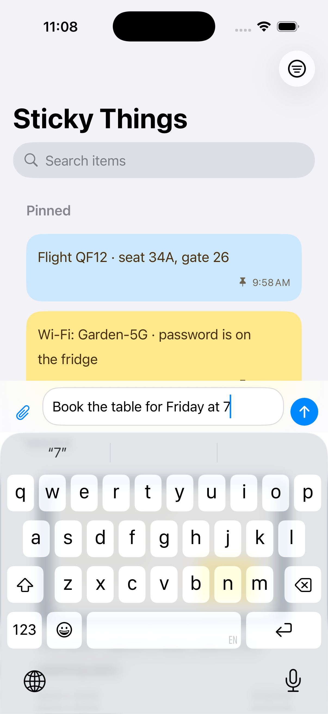
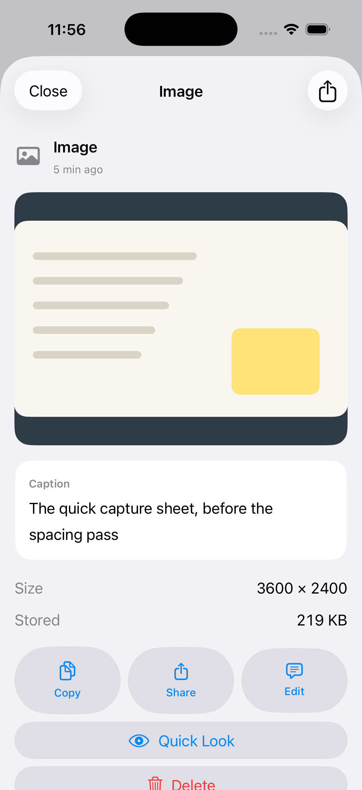
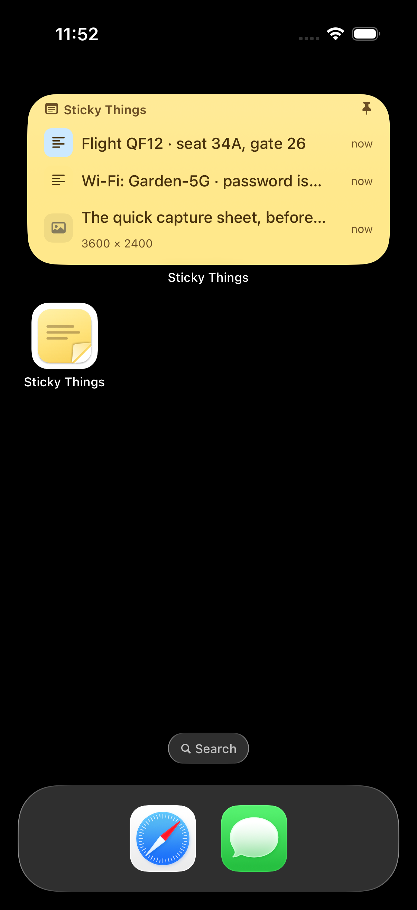

# Sticky Things for iOS

A native iOS companion to the Mac app. The idea is not to shrink the Mac panel onto a phone. It is to use the places iOS already gives you for a 5-second capture: the Action Button, Control Center, the Lock Screen, the share sheet, Siri, and Spotlight.

<p align="center">
  
  
  
  
  
</p>


## What is here

- **Persistent composer:** a ChatGPT-style input bar at the bottom of the library, always ready for a note, link, photo or file. The Action Button and Control Center focus it with the keyboard up; there is no plus button and no intermediate sheet.
- **Action Button + Control Center:** the `New Sticky Thing` control opens the app straight into the composer. Add it from Settings > Action Button > Controls, or Control Center > + > Add a Control > Sticky Things.
- **Lock Screen:** the same control can be placed in the Lock Screen controls.
- **Home Screen widget:** pinned and recent items in small, medium and large sizes, plus Lock Screen accessory variants. Rows deep-link to the item; the large widget has a New Sticky Thing button.
- **Share extension:** save text, links, photos, PDFs and files from other apps without opening Sticky Things.
- **App Shortcuts:** "New sticky thing in Sticky Things" and "Save to Sticky Things" work with Siri and Shortcuts.
- **Spotlight:** saved items are indexed on device. Tapping a result opens the item detail. Concealed copies are never indexed.
- **Native gestures:** text paste, context menus, swipe actions, share sheet, Quick Look on iPad, and drag and drop into the list.
- **Same library format:** the iOS app and its Share extension use the same SQLite schema, blob store and item JSON as the Mac app.

## Build

You need Xcode 26 or newer and iOS 18 or newer. The Xcode project is generated from `project.yml` with [XcodeGen](https://github.com/yonaskolb/XcodeGen), which is installed by Homebrew.

```bash
brew install xcodegen
make ios-project
make ios-build
make ios-open
```

`make ios-build` builds for the generic iOS Simulator without signing. To run on a device:

1. Open `apps/ios/StickyThings.xcodeproj`.
2. Select your Development Team for both `StickyThings` and its extensions.
3. Register the App Group `group.app.stickythings` for the app, Share extension and widget extension where required.
4. Build and run.

The app group is what lets the Share extension write into the same library the app reads. Without it, both processes fall back to their own Application Support directories.

## Data

On iOS the library lives in the App Group container:

```text
group.app.stickythings/Sticky Things/library.sqlite
group.app.stickythings/Sticky Things/blobs/
group.app.stickythings/Sticky Things/files/
```

The Mac app uses the same schema and layout in `~/Library/Application Support/Sticky Things/`. Sync between platforms is not wired up yet; that is the next big piece.

## Testing the system entry points

- **Action Button:** Settings > Action Button > Controls > Sticky Things > New Sticky Thing. Pressing the button should open the composer.
- **Control Center:** swipe down, tap +, add the New Sticky Thing control, tap it.
- **Home Screen widget:** long-press the Home Screen, tap +, choose Sticky Things, and try small, medium and large. Pinned items should be first, rows should open the item, and the large widget's New Sticky Thing button should open the composer.
- **Share:** share a link from Safari, a photo from Photos, and a PDF from Files. Each should appear in the library after tapping Save.
- **Siri/Shortcuts:** "New sticky thing in Sticky Things" and a Save to Sticky Things action with text.
- **Spotlight:** search for a saved note from the Home Screen and tap the result.
- **iPad:** drag a link, image or file from another app into the list.

The simulator builds the controls and extension, but the Action Button and Control Center picker only exist on a real device.

## Not done yet

- iCloud or CloudKit sync between Mac and iPhone
- camera/document scanning as a first-class capture source
- importing the Mac library into the iOS App Group
